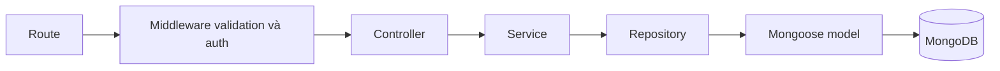

# Kiến trúc backend MyFAP

Backend Express + Mongoose được chia theo trách nhiệm. Các tính năng học vụ/profile mở rộng schema; xem STUDENT_AFFAIRS.md để chuẩn hóa học kỳ và cập nhật ngành ban đầu cho dữ liệu cũ. Không chạy seed toàn bộ lên database đã có dữ liệu.

```text
src/
├── config/          # Kết nối và cấu hình MongoDB
├── routes/          # URL, HTTP method, quyền và validation middleware
├── controllers/     # Nhận dữ liệu đã validate, gọi service, trả HTTP response
├── services/        # Nghiệp vụ, phân quyền theo dữ liệu, version, transaction
├── repositories/    # Truy vấn/lưu MongoDB, repository theo từng model
├── models/          # Mongoose schema, index, reference và model registry
├── validators/      # Zod schema cho body, query và ObjectId
├── middlewares/     # Xác thực, role, validation, rate limit và xử lý lỗi
├── utils/           # Serialize, crypto, ID, version, slot và lỗi dùng chung
├── jobs/            # Áp dụng chuyển ngành đến hạn
├── scripts/         # Init replica/index, seed, import và chuẩn hóa lịch cũ
├── app.js           # Lắp middleware và route
└── server.js        # Khởi tạo DB và mở HTTP server
```



## Trách nhiệm các lớp

| Lớp | Nên làm | Tránh làm |
|---|---|---|
| Route | Khai báo endpoint, role, validator và controller | Truy vấn DB hoặc xử lý nghiệp vụ |
| Controller | Lấy req.user/params/validated, gọi service và đặt HTTP status | Dùng model/repository trực tiếp |
| Service | Kiểm tra điều kiện nghiệp vụ, phạm vi dữ liệu, transaction và audit | Nhận req/res/next hoặc gọi Mongoose |
| Repository | Xây/thực thi query, save document, dùng Mongo session | Quyết định quyền HTTP hoặc nghiệp vụ đăng ký |
| Model | Kiểu dữ liệu, validation lưu trữ, index | Xử lý HTTP |

Service nhận đối số rõ ràng, không phụ thuộc Express. Controller dùng `req.validated.body/query` thay cho body/query thô. Các route ID đi qua `validateId`; lỗi được xử lý tập trung tại error middleware.

Các repository theo thực thể dùng chung `MongooseRepository` để tránh lặp CRUD. `EnrollmentRepository.activeCounts()` thực hiện một aggregation đếm chỗ của toàn bộ danh sách lớp, thay vì query từng lớp. Repository trả document Mongoose khi cần optimistic version; thao tác lưu tập trung qua `saveDocument()` trong repository.

## Ví dụ luồng đăng ký

`POST /api/sections/:id/enrollments`:

1. `routes/academic.routes.js`: yêu cầu STUDENT/STAFF và schema tương ứng.
2. `controllers/enrollment.controller.js` → `registerStudent()`.
3. `services/enrollment.service.js` → `registerStudent()` mở transaction, gọi `enroll()`.
4. Service kiểm tra ngành/chương trình, lịch có sẵn, lớp mở, chỗ còn, trùng môn/học kỳ và trùng lịch.
5. `section`, `enrollment`, `class-session`, `enrollment-period` repositories đọc/ghi dữ liệu; service ghi audit qua audit service.

Mọi truy vấn trong transaction nhận cùng `session`. Không chạy các truy vấn transaction song song bằng Promise.all. Callback retry phải tạo/đọc document lại, không giữ document đã thay đổi từ lần thử trước. Không thêm writer bỏ qua khóa học vụ dùng chung trong `repositories/transaction.js`.

## Các service chính

- `auth.service.js`: login, xác minh phiên, logout, đồng bộ chuyển ngành đến hạn.
- `profile.service.js`: hồ sơ bốn role, sửa liên hệ, đổi mật khẩu và thu hồi phiên.
- `major.service.js`: ngành/chương trình, duyệt và áp dụng chuyển ngành từ kỳ sau.
- `notice.service.js`: nháp/phát hành/lưu trữ thông báo, phân phối và xác nhận đọc.
- `report.service.js`: thống kê điểm danh/đơn theo phạm vi bộ môn.
- `academic-bootstrap.service.js`: chuẩn hóa học kỳ cũ có kiểm tra, giữ lịch sử.
- `catalog.service.js`: bộ môn, môn, kỳ, phòng và cấp tài khoản.
- `section.service.js`: lớp, trạng thái đăng ký và số chỗ.
- `enrollment.service.js`: đăng ký/rút, lịch sử khoảng đăng ký.
- `session.service.js`: đọc lịch, tạo buổi, thay đổi lịch/trạng thái và lịch sử.
- `scheduling.service.js`: kiểm tra xung đột, đổi slot, lưu snapshot lịch.
- `attendance.service.js`: roster, ghi/đọc điểm danh và lịch sử sửa.
- `request.service.js`: đơn nghỉ và đơn đổi lịch/phòng.
- `access.service.js`: giới hạn bộ môn/lớp/cá nhân và roster tại thời điểm buổi học.
- `audit.service.js`, `request-state.service.js`: audit và thay đổi trạng thái đơn khi hủy buổi.
- `import.service.js`, `legacy-repair.service.js`, `seed.service.js`: nghiệp vụ phục vụ CLI.

## Khi thêm chức năng

Thêm schema/route → controller → service; đặt query dùng lại hoặc aggregation riêng trong repository tương ứng. Dùng validator để giới hạn đầu vào; service kiểm tra quyền sở hữu và tham chiếu trước khi ghi. Giữ transaction, version và audit cho các thao tác học vụ. Không trả password hash/token hash ra API và không truyền body thô làm MongoDB filter.

Chạy `npm test`, `npm run test:workflow`, `npm run test:affairs`, `npm run test:import` theo hướng dẫn database test riêng trong README ở thư mục gốc; chạy `npm run format:check` trước khi commit. Các lệnh npm và start-local vẫn sử dụng như trước; mã CLI nằm ở `src/scripts/`.
