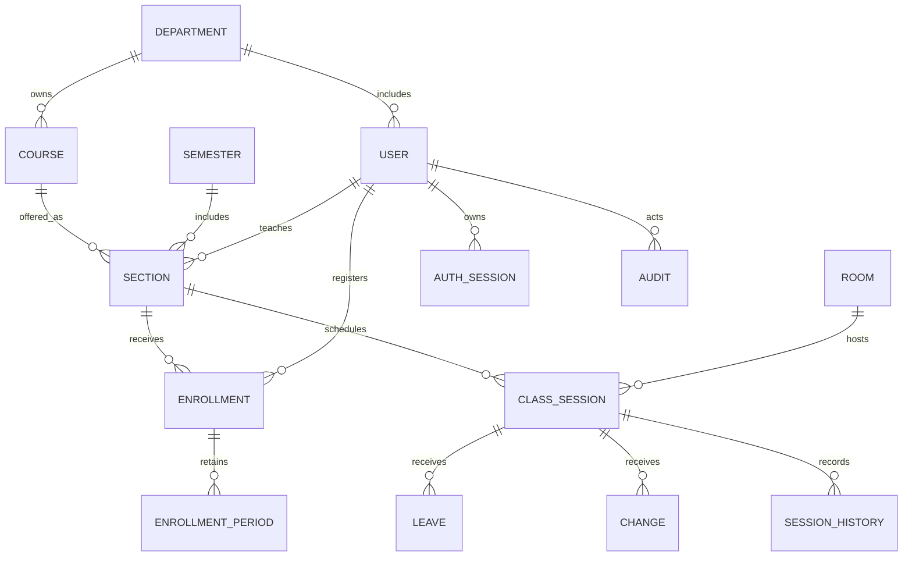

# Mô hình dữ liệu MongoDB Mongoose

Schema thực thi ở `backend/src/models.js`. Không còn schema SQL/FK; tham chiếu được kiểm tra trong service, index kiểm soát duy nhất và transaction replica set bảo vệ thao tác nhiều collection.

| Model | Nội dung chính |
|---|---|
| Department | code/name duy nhất theo mã bộ môn |
| Course | code/name, department_id |
| Semester | code/name, start_at/end_at |
| User | user_code, email duy nhất; password_hash ẩn; role, department_id, active |
| AuthSession | user_id, hash token, expires_at; TTL index tự dọn phiên hết hạn |
| Room | tên phòng và sức chứa |
| Section | môn, kỳ, bộ môn, giảng viên; capacity=30, OPEN/CLOSED; unique(semester_id,code) |
| Enrollment | trạng thái ACTIVE/WITHDRAWN, thời điểm và version; unique(section,student) và unique active(student,course,semester) |
| EnrollmentPeriod | các khoảng starts_at/ends_at; chỉ một khoảng mở cho cặp lớp/sinh viên |
| ClassSession | ngày/slot, giờ UTC, phòng, giảng viên, trạng thái và tối đa 30 dòng attendance nhúng |
| Leave | snapshot ngày/slot/giờ của đơn; reviewer, status; unique active(session,requester) |
| Change | lịch gốc và lịch đề xuất, version buổi gốc; chỉ một PENDING trên một buổi |
| Audit | actor/action/entity, before_data/after_data, thời gian |
| SessionHistory | lịch cũ/mới, người thao tác và đơn liên quan |
| AcademicLock | một document được ghi trong mọi transaction học vụ |
| ImportBatch | source hash và số lượng để nhập dữ liệu cũ không nhân đôi |

4 slot là cấu hình cố định trong `slots.js`, không mở API sửa slot. Ngày là chuỗi YYYY-MM-DD theo Việt Nam; thời gian là BSON Date UTC. ID dùng ObjectId, khi trả API đổi `_id` thành `id`. `legacy_id` giữ ID số để đối chiếu sau import.

Các đường quan hệ biểu diễn tham chiếu nghiệp vụ, không phải FK MongoDB tự thực thi. Điểm danh là subdocument trong ClassSession vì luôn bị chặn ở 30 dòng; đọc/ghi danh sách và version của buổi cùng một document. Audit và lịch sử không nhúng để tránh document tăng vô hạn.

Danh sách điểm danh của buổi dựa vào khoảng đăng ký phủ thời điểm start_at. Rút lớp chỉ đóng khoảng đang mở; không xóa dữ liệu quá khứ. Các truy vấn lịch của sinh viên không trả attendance của người khác; xem lịch lớp trước đăng ký chỉ có thông tin lịch.

Index buổi học chặn trùng section/room/lecturer theo ngày và slot khi SCHEDULED/COMPLETED; buổi CANCELLED giải phóng slot. Service còn kiểm tra khoảng thời gian và trùng sinh viên. Unique index active của enrollment chặn đăng ký nhiều lớp của một môn cùng kỳ. Số 30 và kiểm tra chỗ trống được bảo vệ bằng transaction + khóa chung, không chỉ dựa vào count ở frontend.

Khóa chung phù hợp quy mô đồ án; khi tải ghi lớn có thể tách khóa theo tài nguyên sau khi có kiểm thử đồng thời. Không cho writer bên ngoài bỏ qua service. Mongoose ref không bảo đảm đối tượng tồn tại nếu sửa trực tiếp MongoDB; API tạo/duyệt đều kiểm tra tham chiếu và phạm vi quyền.

Audit/SessionHistory chỉ được thêm qua ứng dụng, không có API sửa/xóa. Tài khoản DB có quyền rộng vẫn có thể sửa nên khi triển khai cần giới hạn đặc quyền. Khôi phục lịch sử trước khi có snapshot là không thể; importer không bịa original_* cho đơn cũ.
