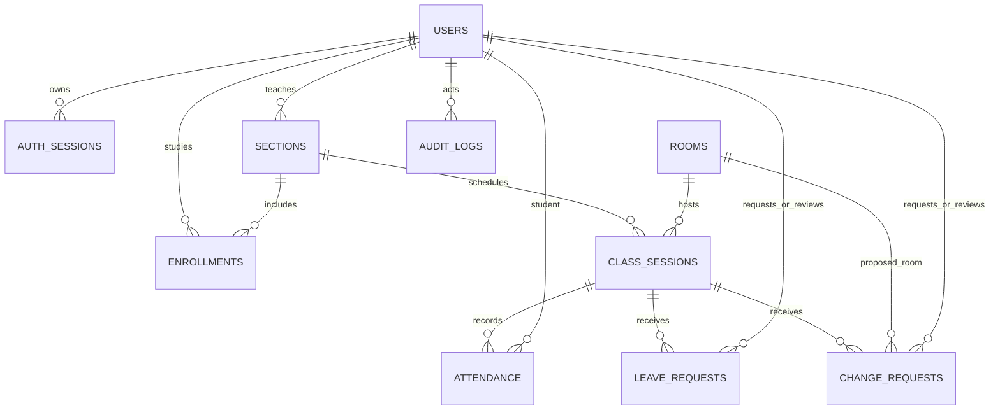

# ERD MyFAP theo phạm vi mới

Schema chi tiết nằm ở `backend/schema.sql`: 11 bảng gồm academic_lock. Không có bảng điểm. Bộ môn là mã chuỗi trên users/sections cho MVP, chưa có danh mục bộ môn/học kỳ/môn học riêng; có thể chuẩn hóa khi triển khai quản trị danh mục.

Các lựa chọn khác báo cáo: dùng user duy nhất với role thay vì profile phụ khi chưa có dữ liệu đặc thù; session tách lớp học phần để một lớp có nhiều buổi; attendance có PK(session_id,student_id); leave_requests duy nhất theo buổi và sinh viên. Change request giữ phiên bản lịch gốc và có generated column UNIQUE để chỉ một đơn chờ trên mỗi buổi. Đơn không xóa sau duyệt để giữ lịch sử.

Auth_sessions chỉ giữ hash token và hạn sử dụng. Cần định kỳ dọn phiên hết hạn khi triển khai lâu dài. Audit_logs chỉ được thêm qua API, không có API sửa/xóa; tài khoản DB có quyền SQL vẫn có thể sửa nên môi trường triển khai cần giới hạn đặc quyền riêng.

Khóa ngoại bảo vệ tham chiếu; phân quyền, vai trò giảng viên/sinh viên, danh sách điểm danh và trùng khoảng thời gian được kiểm tra trong backend. Mọi writer học vụ trong API dùng transaction và khóa academic_lock. Nếu thêm API sửa hồ sơ/lớp/lịch sau này phải dùng cùng cơ chế; không cho phép writer bên ngoài bỏ qua ràng buộc này.
